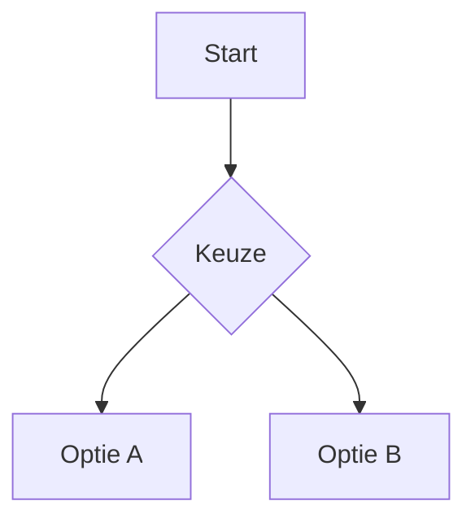

# FHIR R6 – setup

1. Pak de ZIP uit.
2. Open de map `fhir-r6-setup` in VS Code via **File > Open Folder**. Zo worden de meegeleverde workspace-instellingen geladen.
3. Open `slides.md` en druk **Ctrl+Shift+V** voor Markdown Preview (Linux/Windows).
4. Gebruik een recente VS Code-versie. De huidige ingebouwde Markdown Preview ondersteunt Mermaid. Als jouw oudere versie alleen code toont, werk VS Code bij of gebruik de extensie Markdown Preview Mermaid Support (`bierner.markdown-mermaid`).

De preview toont de slides onder elkaar. Voor navigatie met pijltjestoetsen als echte diavoorstelling is een aanvullende presentatieoplossing nodig.

## Bestanden

- `slides.md`: titelslide plus lege vervolgslide.
- `slides.css`: lichte sepia (#f5efdf), donkergrijs (#383838), sans serif, logo en footer.
- `.vscode/settings.json`: laadt de CSS voor de Markdown Preview.
- `assets/hl7-nederland.png`: logo van hl7.nl, lokaal meegeleverd.

Kopieer het volledige `<div class="slide">`-blok om een slide toe te voegen. Behoud de lege regels rond de Markdown binnen het blok. De titelslide heeft geen logo en footer. De vervolgslide heeft beide.

## Mermaid toevoegen

Plak bijvoorbeeld dit codeblok in een vervolgslide:

````markdown

````

Diagramkleuren volgen standaard de Mermaid-renderer van VS Code. De CSS bepaalt de sepia-achtergrond en tekstkleur van de slide zelf.

## Aanpassen

Bewerk kleuren, font en maten in `slides.css`. Het ontwerp richt zich op een brede preview met ongeveer 16:9-verhoudingen. Bij veel inhoud groeit een slide mee om afkappen te voorkomen.

Bronnen setup:
- https://code.visualstudio.com/docs/languages/markdown (CSS en Mermaid)
- https://hl7.nl/ (logo)

De setup is structureel gecontroleerd, maar niet in jouw lokale VS Code-installatie getest.
