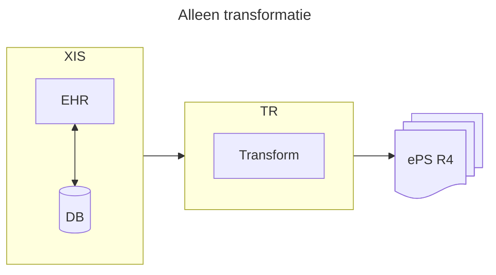
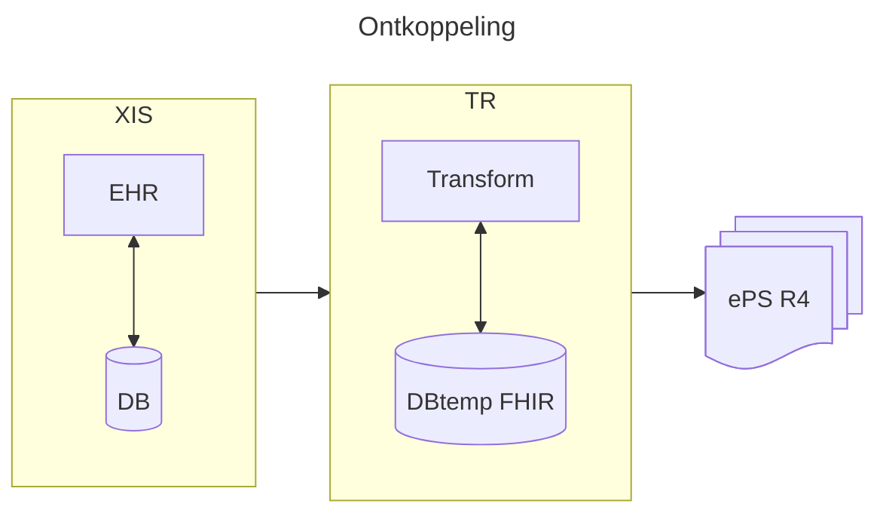
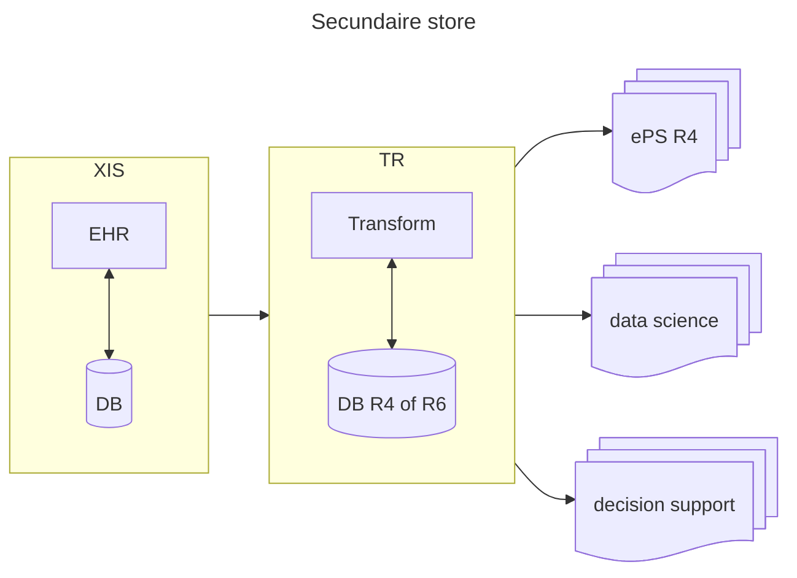

---
presentation:
  width: 1280
  height: 720
---

<!-- slide -->

# FHIR R6, wat is er nieuw?

### Marc de Graauw
### HL7 NL WGM november 2026

<!-- slide -->

## Waarom R6?

- EHDS gebruikt FHIR R4
- er is meer dan de EHDS
- mogelijke architecturen

<!-- slide -->

## Setup 1: alleen EHDS transform

- alleen transformatie
- on the fly
- alleen EHDS

<!-- slide -->

## Setup 2: transform temporary store

- tijdelijke opslag voor transformatie
- ontkoppeling proprietary DB van FHIR
<!-- slide -->

## Setup 3: permanent secondary store

- multi purpose
- (semi)permanente opslag

<!-- slide -->

## Tijdpad van FHIR

- R1 (DSTU) — februari 2014 — niet-normatief
- R2 (DSTU2) — oktober 2015 — niet-normatief
- R3 (STU3) — maart 2017 — niet-normatief
- R4 — december 2018 — gemengd: eerste normatieve inhoud naast STU
- R4B — mei 2022 — niet-normatief (STU)
- R5 — maart 2023 — niet-normatief (STU); normatieve inhoud uit R4 blijft behouden
- R6 — 2025–2026: ballotrondes en verwerking van commentaar; eerste normatieve ballot in 2026
- R6 — beoogde normatieve publicatie in 2027; datum is voorlopig

<!-- slide -->

## Normatief of niet-normatief?

- **Normatief:** formeel vastgesteld en stabiel; wijzigingen volgen strikte compatibiliteitsregels.
- **Niet-normatief (STU):** bedoeld om te implementeren en te beproeven; kan op basis van feedback nog veranderen, ook incompatibel.
- De status geldt per onderdeel: één release kan beide statussen bevatten.

<!-- slide -->

## Observation: R4 → R6

- **Panelen:** nieuw `organizer`-veld maakt expliciet dat een Observation andere metingen groepeert.
- **Herkomst:** `supportingDevice` legt vast welk apparaat de meting ondersteunt.
- **Context:** extra `statusReason` en duidelijkere richtlijnen voor context en meetmethode.
- **Vitale functies:** profielen en regels voor bloeddrukmetingen zijn aangescherpt.

*R6 is nog in ontwikkeling; details kunnen wijzigen. [FHIR Observation](https://build.fhir.org/observation.html)*

<!-- slide -->

## Resources buiten FHIR R6 core

<!-- slide -->
### [OO Incubator](https://build.fhir.org/ig/HL7/oo-incubator/index.html)

- BiologicallyDerivedProductDispense
- DeviceDispense
- DeviceUsage
- InventoryItem
- InventoryReport
- SupplyDelivery
- SupplyRequest
- Transport
<!-- slide -->
### [Administrative Incubator](https://build.fhir.org/ig/HL7/admin-incubator/index.html)

- ChargeItem
- ChargeItemDefinition
- EncounterHistory
- PersonalRelationship
- VerificationResult
<!-- slide -->
### [Patient Care Incubator](https://build.fhir.org/ig/HL7/pc-incubator/index.html)

- ClinicalAssessment
- ConditionDefinition
- Linkage
<!-- slide -->
### [FM Incubator](https://build.fhir.org/ig/HL7/fm-incubator/index.html)

- Contract
- EnrollmentRequest
- EnrollmentResponse
- InsurancePlan
- InsuranceProduct
- Invoice
<!-- slide -->
### [Pharmacy Incubator](https://build.fhir.org/ig/HL7/phx-incubator/index.html)

- FormularyItem

### [FHIR Genomics Resource Incubator](https://build.fhir.org/ig/HL7/cg-incubator/index.html)

- GenomicStudy
- MolecularDefinition

### [Immunization Incubator Implementation Guide](https://build.fhir.org/ig/HL7/immunization-incubator/en/index.html)

- ImmunizationEvaluation
- ImmunizationRecommendation
<!-- slide -->

### [Evidence Based Medicine](https://build.fhir.org/ig/HL7/ebm/index.html)

- Citation

### [API Incubator](https://build.fhir.org/ig/HL7/api-incubator-ig/index.html)

- GraphDefinition

### [FHIR Mapping Language](https://build.fhir.org/ig/HL7/mapping-language-ig/index.html)

- StructureMap

### [FHIR Testing IG](https://build.fhir.org/ig/HL7/fhir-testing-ig/en/index.html)

- TestPlan
- TestReport
- TestScript

